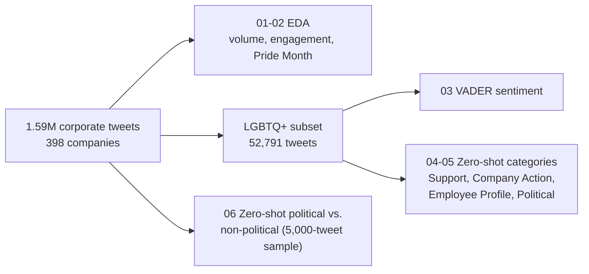

# Corporate Communication on LGBTQ Issues: Social Media Analytics & NLP

Independent study (McGill MMA) on how large companies talk about LGBTQ+ topics on Twitter/X. It combines exploratory analysis of 1.6 million corporate tweets with VADER sentiment analysis and transformer-based zero-shot classification (`facebook/bart-large-mnli`) to measure what kinds of messages companies send and how political they are. 

## Main findings

- **Corporate LGBTQ+ communication is concentrated around Pride Month**, with meaningful variation across companies and years. The LGBTQ+ subset is 52,791 tweets (3.3%) from 390 companies, out of 1,585,500 tweets from 398 companies (Jan 2018 to Jul 2024).
- **Sentiment is overwhelmingly positive, and the negative tweets are mostly supportive.** VADER scores 80.6% of LGBTQ+ tweets positive, 14.3% neutral and 5.1% negative. The negative examples I reviewed were mostly statements condemning violence or discrimination, so negative wording isn't negative attitude.
- **Supportive messaging is the clearest category; "Employee Profile" is a weak catch-all.** Support tweets are classified with by far the highest confidence (mean 0.65 vs. 0.43 to 0.48 for the others). Employee Profile is the top-scoring category for 70.1% of tweets, but many of those are low-confidence assignments of general diversity posts (see [confidence scores](#how-to-read-the-confidence-scores)).
- **Explicitly political messaging is rare.** Political Statement is the top category for only 4.4% of LGBTQ+ tweets. Across all corporate tweets (5,000-tweet sample), 14.6% score above 0.5 for "political," but only 0.8% score above 0.8.

## Data

- 1,585,500 tweets from 398 companies, January 2018 to July 2024; 52,791 are flagged as LGBTQ+-related in the provided data. About 54% of the tweets are replies, mostly customer service.
- **The data is not in this repo.** Raw tweets and classified output files are excluded because of X/Twitter's terms and because the dataset isn't mine to redistribute. Individual tweets and user handles were also removed from the notebook outputs. Charts and aggregate tables are kept. The examples below are paraphrased.

## Pipeline



| Notebook | What it does | Key result |
|---|---|---|
| `01_corporate_tweet_eda` | Validation and cleaning, volume by year and company, engagement, Pride Month analysis (June vs. rest of year, before/during/after), LGBTQ+ share by year, original-posts-only view | No missing values or duplicates; Pride Month concentration |
| `02_eda_excluding_netflix` | Same analysis without Netflix, whose entertainment content differs from typical corporate messaging | See charts |
| `03_vader_sentiment` | VADER on the 52,791 LGBTQ+ tweets, by year, month and company | 80.6% positive, 14.3% neutral, 5.1% negative |
| `04_zero_shot_single_label` | First approach: one category per tweet | Employee Profile 37,018; Company Action 7,969; Support 5,471; Political 2,333 |
| `05_zero_shot_multilabel` | Final approach: every tweet scored independently on all four categories | Average scores: Employee Profile 0.41, Company Action 0.24, Support 0.18, Political 0.17 |
| `06_political_zero_shot_classification` | Political vs. non-political probability for all corporate tweets, by year, month, company and engagement | Run on a 5,000-tweet sample: 14.6% above 0.5 |

A short write-up of the questions and methods is in [`docs/Executive_Summary_Report.pdf`](docs/Executive_Summary_Report.pdf).

## Do the classifications make sense?

I read the example tweets the notebooks print for each category and checked them by eye. This is a qualitative check on a handful of tweets, **not an accuracy measurement**. Descriptions are paraphrased.

**LGBTQ+ categories (notebook 05)**

| Paraphrased tweet | Assigned category | Score | Sensible? |
|---|---|---|---|
| Pride Month post celebrating the LGBTQ+ community and its allies | Support | 0.99 | Yes |
| Post about an LGBT-inclusion certification (anti-discrimination protections, employee groups) | Company Action | 0.98 | Yes |
| Employer recognized by a workplace equality index, with HR policies | Company Action | 0.96 | Yes |
| Executive shares her personal journey | Employee Profile | 0.95 | Yes |
| Celebration of the women who work at the company (International Women's Day) | Employee Profile | 0.56 | Partly: not LGBTQ+-specific |
| Concert tour ticket announcement | Employee Profile | 0.42 | No: fits none of the categories |
| Sponsoring a youth leadership program | Employee Profile | 0.34 | No: low confidence flags it |

**Political vs. non-political (notebook 06)**

| Paraphrased tweet | Score | Sensible? |
|---|---|---|
| Head of equities on the upcoming US election | 0.98 | Yes |
| Applauding a Supreme Court ruling on LGBTQ+ workplace rights | 0.96 | Yes |
| Thanking a congressman for co-sponsoring a bill | 0.94 | Yes |
| Preparing for GDPR | 0.92 | Reasonable (regulation) |
| Short reply about getting someone's vote | 0.89 | No: false positive |
| Beer and baseball, a show launch, thawing meat safely | 0.02 to 0.04 | Yes |
| Customer-service replies ("send us a DM with your details") | 0.45 to 0.55 | Uncertain, as expected |

**Takeaways.** High-confidence tweets (above about 0.9) are almost always classified sensibly. Low scores usually flag tweets that don't fit the labels well. The weaknesses are false positives from short or ambiguous tweets and a tendency to push general diversity content into "Employee Profile."

## How to read the confidence scores

- **Notebook 05 (multi-label):** each tweet gets four independent scores between 0 and 1 for Support, Company Action, Employee Profile and Political Statement. They don't sum to 1, so one tweet can score high on several. **Confidence** is the highest of the four.
- **Notebook 04 (single-label):** the same model, but the four scores compete, so each tweet gets one category.
- **Notebook 06:** a two-way choice (political vs. non-political) gives a political probability between 0 and 1. A tweet is labeled political above 0.5.

| Category (highest score) | Mean confidence |
|---|---|
| Support | 0.65 |
| Employee Profile | 0.48 |
| Company Action | 0.48 |
| Political Statement | 0.43 |

- The mean confidence is 0.49, and **25.1% of tweets (13,235) fall below 0.4.** About two thirds of those (8,734) are labeled Employee Profile, mostly general diversity and inclusion posts that fit none of the four categories well. So the 70% Employee Profile share is largely made of weak assignments, and the category counts should be read as soft.
- **Political results depend on the cutoff.** On the 5,000-tweet sample, 14.6% of tweets are above 0.5, 119 (2.4%) are above 0.7, and only 0.8% are above 0.8. 14.2% fall in the uncertain 0.45 to 0.55 range, and the examples there are almost all generic customer-service replies. A stricter cutoff gives a much smaller and cleaner political set.
- **Rule of thumb:** above 0.8 is reliable, 0.4 to 0.8 is moderate, below 0.4 is uncertain. For analysis, filter to higher-confidence tweets or report results at several cutoffs.

## Other results and caveats

- **Sentiment:** VADER agrees only weakly with the dataset's own sentiment column (Spearman ρ = 0.16). Of the five most negative tweets in the notebook, none expressed hostility: most condemned violence or discrimination or backed anti-bullying work.
- **Engagement vs. political content (5,000-tweet sample):** highly political tweets (above 0.70, n = 119) average more likes (83 vs. 55), retweets (10 vs. 7) and replies (4.7 vs. 2.2) than clearly non-political ones (below 0.30, n = 2,055), but the correlation between political probability and any engagement measure is about 0.01. I wouldn't read much into this at this sample size.
- **The LGBTQ+ subset is broader than LGBTQ+ alone.** Some tweets in it are about wider diversity and inclusion topics (for example Asian American heritage, International Women's Day, Juneteenth), so counts for "LGBTQ+ communication" may be somewhat overstated.

## Limitations

- **The classifiers have not been validated against hand-labeled tweets,** so there are no accuracy figures. The example check above is informal. Hand-labeling a random sample and reporting agreement is the most useful next step.
- **The political classification has only been run on a random 5,000-tweet sample, not all 1.6 million tweets.** Running the full dataset is a one-flag change in notebook 06 (turn off the sampling in section 1.3), but at the roughly 12 tweets per second seen on the Colab GPU, 52,791 tweets takes about 75 minutes and all 1.6 million would take around a day and a half.
- Category descriptions are prompts I wrote, and results depend on their wording. Changing the "Employee Profile" description would likely change the 70% figure.
- Replies are over half of the data, so overall figures mix customer service with brand messaging.
- Comparing communication types against engagement across industries and companies is left as future work.

## How to run

The notebooks were built in Google Colab with the dataset in Google Drive.

1. Put the dataset at `/content/drive/MyDrive/Colab Notebooks/Tweets.csv`, or edit `FILE_PATH` near the top of each notebook.
2. Run the notebooks in order (02 is optional). Use a GPU runtime for 04 to 06. These notebooks save checkpoints to Drive, so an interrupted run can resume.
3. Dependencies are in `requirements.txt` (the Colab runtime already includes most of them).

## Repository layout

```
notebooks/   six analysis notebooks (outputs with tweet text removed)
docs/        executive summary report
requirements.txt
```
